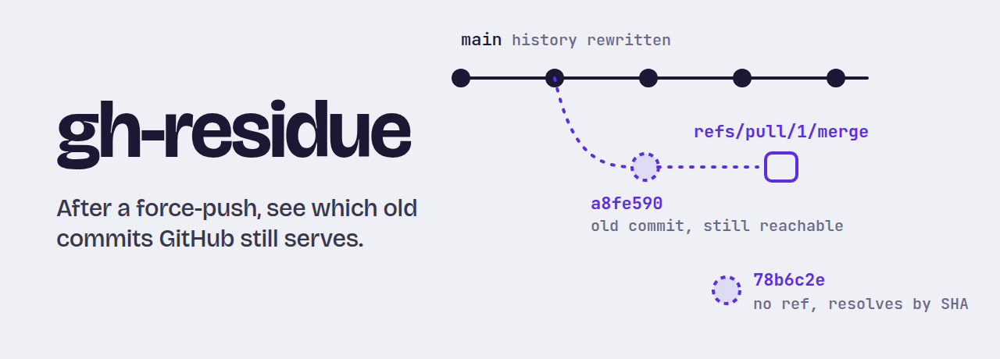

<picture>
  <source media="(max-width: 600px) and (prefers-color-scheme: dark)" srcset="docs/assets/banner-mobile-dark.png">
  <source media="(max-width: 600px)" srcset="docs/assets/banner-mobile-light.png">
  <source media="(prefers-color-scheme: dark)" srcset="docs/assets/banner-dark.png">
  
</picture>

[](https://github.com/0x524a/gh-residue/actions/workflows/ci.yml)
[](https://github.com/0x524a/gh-residue/releases/latest)
[](LICENSE)
[](go.mod)

Rewriting history and force-pushing does not remove the old commits from GitHub. They can stay reachable by SHA, through pull request refs, and from forks. `gh-residue` checks each old commit, shows where it is still reachable, and drafts the request to send GitHub Support.

> **Rotate the leaked credential first.** This tool only checks. It cannot remove anything; only GitHub Support can purge cached views and pull request refs.

## Install

```bash
gh extension install 0x524a/gh-residue
```

Needs the [GitHub CLI](https://cli.github.com). Release binaries carry build-provenance attestations: `gh attestation verify <file> --repo 0x524a/gh-residue` (needs a recent `gh`).

## Use

After rewriting with [`git-filter-repo`](https://github.com/newren/git-filter-repo) and force-pushing:

```bash
gh residue verify OWNER/REPO --input path/to/rewritten/clone
```

`--input` is the clone you rewrote (it reads `.git/filter-repo/commit-map`), or a text file with one full 40-character SHA per line. This is the output for a test repo where one old commit survives only through a pull request, and another was dropped from `main` but still resolves by SHA:

```text
78b6c2ec2bffe0735195752c99177b2604e1bb1b
  confirmed    base_object OWNER/REPO                   HTTP 200
  not_found    branch      *                            object not in mirror
  not_found    pr_ref      *                            object not in mirror
  not_found    tag         *                            object not in mirror

a8fe590d2eb57713e5c3d85b3120fbd995dedd5d
  confirmed    base_object OWNER/REPO                   HTTP 200
  not_found    branch      *                            no ref of this kind contains commit
  confirmed    pr_ref      refs/pull/1/merge            ref contains commit
  not_found    tag         *                            no ref of this kind contains commit

3 SHAs, 2 still exposed (2 via base_object, 1 via pr_ref). Exit code 1.
```

(Trimmed: the run also included a made-up control SHA, which came back `not_found` everywhere, and prints a reminder footer. The repository name is replaced.)

### Reading the result

| Exit code | Meaning | What to do |
|---|---|---|
| `0` | Every check finished and nothing is reachable. | Nothing further. |
| `1` | At least one old commit is still reachable. | Clean up any branch or tag that holds it, then send the Support request. |
| `2` | Not sure: a check failed, hit a rate limit, was skipped, or only a sample of forks was checked. | Treat it as **not clean**. Re-run with the same `--checkpoint` file. |

A failed check is never reported as clean. Anything the tool could not establish is `unknown`, and `unknown` exits `2`.

### Then

```bash
# Save progress; re-running re-checks only what came back unknown
gh residue verify OWNER/REPO --input . --checkpoint cp.json

# Draft the Support request (written to a file, never sent)
gh residue verify OWNER/REPO --input . --checkpoint cp.json --support-draft draft.md

# After Support acts, see what changed
gh residue verify OWNER/REPO --input . --json > before.json
gh residue verify OWNER/REPO --input . --against before.json
```

The draft lists the repository, the affected pull requests, the first changed commit, the old SHAs and your current exposure. It leaves one section blank for you: why rotating the credential cannot reduce the risk. GitHub only helps when it cannot, and the tool will not make that claim for you.

## What it checks

| Surface | Question it answers | Notes |
|---|---|---|
| Base repository | Does the SHA still resolve through your repo's URL? | Finds commits that no branch holds. Uses the REST commit endpoint. |
| Branches, tags, pull request refs | Which refs reach the SHA? | Uses a temporary mirror clone. Catches a PR merge ref that kept the old commit as a parent. |
| Forks | Does the SHA resolve through a fork's URL? | Sampled (200 by default, `--max-forks`) and the coverage is printed. This means the object is resolvable, **not** that the fork holds a ref. |

GitHub says Support acts only once no forks hold references. Checking which forks hold refs is not built yet, so the Support draft's *Ready for Support?* line can say `no` or `unknown`, never `yes`.

## Options

| Flag | Effect |
|---|---|
| `--input PATH` | Rewritten clone or SHA list (required). |
| `--json` | Print JSON instead of the table. Output order is stable, so runs diff cleanly. |
| `--checkpoint FILE` | Resume from `FILE` if it exists, and write the result there. Refused for another repo or results older than `--checkpoint-max-age` (24h). |
| `--against FILE` | Compare with an earlier `--json` run: `resolved`, `still-exposed`, `new`, `now-unknown`. |
| `--support-draft FILE` | Write the Support request draft. Add `--first-changed SHA` and `--lfs-file NAME` from filter-repo's output. |
| `--max-forks N`, `--no-forks` | Size of the fork sample, or skip forks. |
| `--no-mirror` | Skip the clone. The branch, tag and PR surfaces then count as incomplete. |
| `--concurrency N` | Parallel fork requests. Default `1`, as GitHub recommends. |
| `--yes` | Proceed when the printed request estimate is large. |

## Token and rate limits

The token comes from `GH_TOKEN`, `GITHUB_TOKEN` or your `gh` login. Read-only is enough: a fine-grained token with Contents and Metadata read, or a classic token with `repo` for private repositories. Public repositories work without one, at 60 requests an hour. The tool prints an estimate first, honors `Retry-After` and `X-RateLimit-Reset`, and reports whatever it could not finish as `unknown`.

## What it never does

- Remove, push, rewrite, rotate or revoke anything.
- Detect secrets. Other tools do that.
- Read or print commit contents. It stores only SHAs, ref names, repository names and PR numbers.

Reports, checkpoints and drafts list the SHAs of a leak. Do not commit them to a public repository.

## Limits

- Local clones, CI caches and third-party mirrors are out of reach. Public repositories' push events may also sit in archives such as GH Archive; whether force-pushed SHAs reach them is untested.
- The cached web view of a commit is not probed yet.
- CI runs the tests and a release-style build on Linux, macOS and Windows. One Windows gap remains: passing a token to git for the mirror clone goes through a `sh` helper that CI cannot exercise, because it needs an authenticated remote. On Windows, file permissions are not enforced either, so checkpoint and draft files are not restricted to your user.
- 11 claims are still unverified and tagged **(unverified)** in [`docs/10-open-questions.md`](docs/10-open-questions.md).

## Design

The reasoning and the evidence behind it are in [`docs/`](docs/): [problem and scope](docs/01-problem-and-scope.md), [architecture](docs/02-architecture.md), [probes](docs/03-probes.md), [output and data model](docs/04-output-and-data-model.md), [auth and rate limits](docs/05-auth-rate-limits-org-mode.md), [threat model](docs/06-threat-model-and-safety.md), [licensing](docs/07-legal-and-licensing.md), [testing](docs/08-testing-strategy.md), [roadmap](docs/09-roadmap.md), the [decision records](docs/adr/) and the [Gate 0 experiment](docs/spike/gate0-results.md).

## Support

Open an [issue](https://github.com/0x524a/gh-residue/issues) for bugs and questions. Include the command, the exit code and the version from `gh residue --version`; leave out SHAs and any secret.

For anything that does not belong in a public issue, email [0x524a@gmail.com](mailto:0x524a@gmail.com). Do not send SHAs of a live leak or any credential there either.

gh-residue uses the GitHub REST API and is not affiliated with or endorsed by GitHub. The `gh-` prefix is the naming convention for CLI extensions.

## License

[Apache-2.0](LICENSE).
